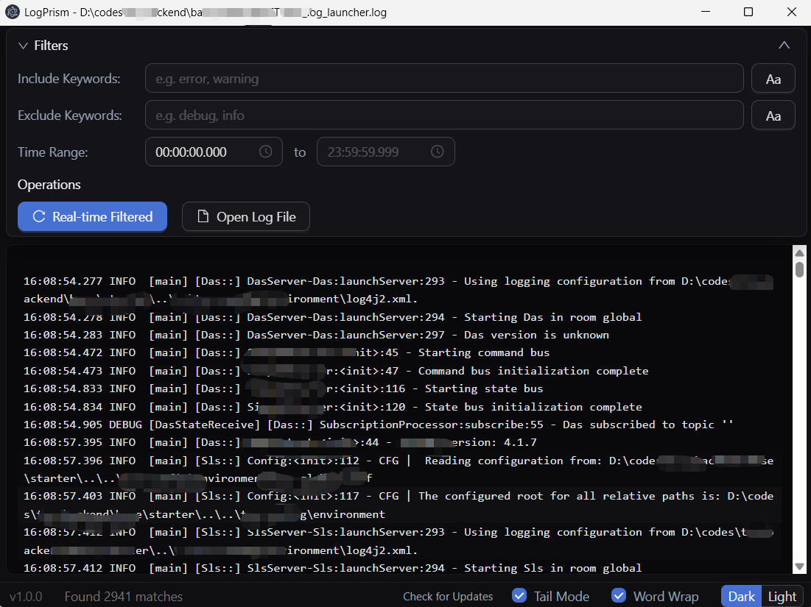
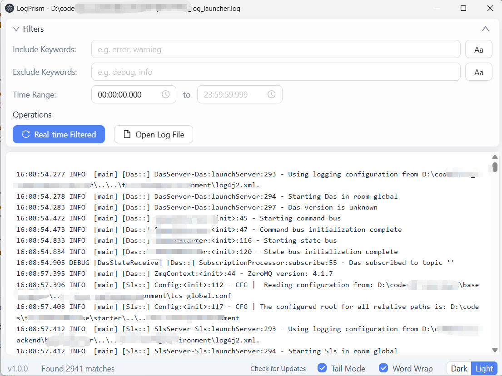
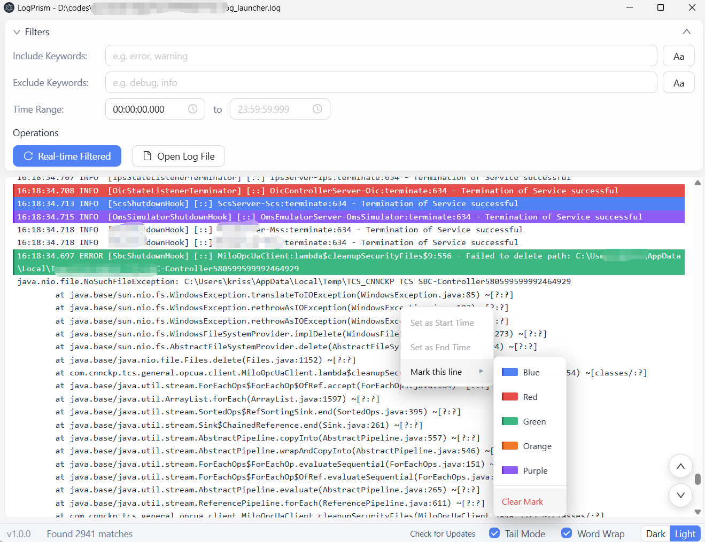

# LogPrism

<p align="center">
  <strong>LogPrism</strong> - A professional, high-performance, and elegant desktop log analysis viewer designed for developers and DevOps.
</p>

<p align="center">
  
  
  
  
  
  
</p>

---

## 📖 Introduction

**LogPrism** is a modern, cross-platform desktop log viewer and analyzer designed to solve the pain points of processing massive production logs: slow loading, clunky filtering, inability to inspect remote servers, and cluttered UIs.

Built with **Electron 39**, **React 19**, and **Ant Design 6**, LogPrism combines GB-level streaming performance, Web Worker off-thread filtering, real-time remote SSH log tailing, multi-tab split comparison, interactive timeline analytics, and native IDE deep-linking into a cohesive, aesthetic dark/light interface.

---

## 🖼️ Screenshots

<p align="center">
  
  <br>
  <sub>Sleek and modern Dark Mode interface with custom highlighting, mini-map timeline, and speed navigation.</sub>
</p>

<br>

<p align="center">
  
  <br>
  <sub>Clean and elegant Light Mode interface with real-time multi-dimensional filters and level badges.</sub>
</p>

<br>

<p align="center">
  
  <br>
  <sub>Interactive features including custom time-range filtering, tailing tracking, and dynamic zoom control.</sub>
</p>

---

## 🛠️ Tech Stack

Built with a high-performance desktop development ecosystem:

- **Desktop Framework**: [Electron 39](https://www.electronjs.org/) (native window management, multi-process architecture, and secure IPC)
- **UI Architecture**: [React 19](https://react.dev/) + [TypeScript 5](https://www.typescriptlang.org/) (component-driven view layer with strict typing)
- **Design System**: [Ant Design 6](https://ant.design/) (custom dynamic themes, Dark/Light mode algorithms, and glassmorphic styling)
- **Build System**: [electron-vite](https://electron-vite.org/) + [Vite 7](https://vitejs.dev/) (fast HMR during development and tree-shaken production bundles)
- **Concurrency & Off-thread Filtering**: [Web Workers](https://developer.mozilla.org/en-US/docs/Web/API/Web_Workers_API) (background regex parsing, timestamp calculation, and keyword filtering without UI thread blocking)
- **Remote Networking**: [ssh2](https://github.com/mscdex/ssh2) (streaming SSH shell execution & SFTP remote file browser)
- **Internationalization**: [i18next](https://www.i18next.com/) + [react-i18next](https://react.i18next.com/) (full English & Simplified Chinese translation with persistence)
- **App Packaging & Updates**: [electron-builder](https://www.electron.build/) + [electron-updater](https://www.electron.build/auto-update) (automated GitHub Release updates and multi-platform packaging)

---

## 🏗️ Architecture

LogPrism implements a secure, modular **multi-process architecture** enhanced with Web Workers for heavy compute:

```
my-log-viewer/
├── src/
│   ├── main/                  # Main Process (Node.js runtime)
│   │   ├── index.ts           # App lifecycle, window management, IPC handlers & auto-update
│   │   ├── logIndexer.ts      # Binary offset indexing (Uint32Array) & native .gz decompression
│   │   ├── sshManager.ts      # SSH2 client, remote log tailing & SFTP file browsing
│   │   └── ideaLauncher.ts    # IntelliJ IDEA deep-linking (idea://open) & executable resolution
│   │
│   ├── preload/               # Secure Preload Bridge
│   │   ├── index.ts           # Exposes type-safe APIs via contextBridge
│   │   └── index.d.ts         # Global window.api interface definitions
│   │
│   └── renderer/              # Renderer Process (React 19 + Ant Design)
│       └── src/
│           ├── components/    # Reusable UI Components
│           │   ├── TabBar.tsx                 # Multi-tab bar, split views & scroll synchronization
│           │   ├── LogViewer.tsx              # Application shell & multi-tab orchestrator
│           │   ├── LogSingleViewer.tsx        # Single log workspace, controls & context menus
│           │   ├── VirtualLogList.tsx         # 60fps DOM virtualized log list & text selection
│           │   ├── LogTimeline.tsx            # Mini-map density timeline & spike chart
│           │   ├── PayloadInspectorDrawer.tsx # Tree & code view inspector for embedded JSON/XML
│           │   ├── RemoteLogModal.tsx         # SSH connection dialog & profile manager
│           │   ├── RemoteFileBrowserModal.tsx # SFTP remote file browser with extension filters
│           │   ├── KeywordHistoryInput.tsx    # Keyword input with search history dropdown
│           │   └── KeyboardShortcutsModal.tsx # Interactive keyboard shortcuts guide
│           ├── workers/
│           │   └── logFilter.worker.ts        # Off-thread Web Worker for filtering and parsing
│           ├── i18n/                          # Multi-language translation dictionaries (en, zh)
│           └── utils/                         # Stack trace parser, timestamp & payload detectors
│
├── scripts/mock-server/       # Built-in dynamic log generator & Mock SSH server
└── resources/                 # Application icons and static assets
```

---

## ✨ Core Features

### ⚡ 1. High-Performance GB-Level Indexing & Virtual Scrolling

- **GB-Level Log Loading**: Instant indexing and slicing for large log files (tested on <= 1GB production logs with millions of lines).
- **Native Gzip Support (`.gz` / `.log.gz`)**: Directly reads and indexes compressed `.gz` and `.log.gz` files on the fly without decompressing them to disk.
- **75% Memory Reduction**: High-density binary offset indexing with `Uint32Array` keeps indexing memory overhead under ~40MB even for 10 million lines.
- **Web Worker Background Filtering**: Heavy parsing tasks—regex matching, timestamp extraction, multi-line grouping, and filtering—are offloaded to a background Web Worker, ensuring zero UI lag or dropped frames when typing search terms.
- **60fps Virtual List**: DOM virtualization (`VirtualLogList`) renders only visible log lines, complete with text selection restoration across scrolling.

### 🌐 2. Remote Server Access (SSH & SFTP)

- **Real-Time SSH Log Tail**: Connect to remote Linux/Unix servers over SSH (supporting both Password and SSH Private Key authentication) and tail logs live into the viewer.
- **SFTP Remote File Browser**: Browse remote directories with the interactive file explorer (`RemoteFileBrowserModal`) and filter by file extension (`.log`, `.txt`, `.gz`, `*.*`).
- **Connection Test & Profiles**: Dedicated "Test Connection" button to verify SSH credentials and directory paths; save and switch between multiple remote server profiles.

### 📑 3. Multi-Tab Workspace & Split-Screen Comparison

- **Multi-Tab Browsing**: Open multiple local files or remote SSH streams simultaneously in separate tabs.
- **Split Views (Horizontal & Vertical)**: Split the viewer horizontally or vertically to compare two different logs side-by-side or stacked.
- **Scroll Synchronization**: Optional **Scroll Sync** locks scrolling between split panes for precise line-by-line timeline comparisons.
- **Tab Context Operations**: Right-click tabs to Close, Close Others, or Close All.

### 🔍 4. Multi-Dimensional Search & Filtering

- **Include Keywords**: Filter lines matching keywords (supports space-delimited words, exact phrase matching using double quotes `"exact phrase"`, and Case Sensitivity `Aa` toggle).
- **Exclude Keywords**: Instantly filter out irrelevant noise using the same flexible syntax.
- **Keyword Search History**: Google-like search history dropdown for both Include and Exclude keywords; click to reapply or remove individual terms.
- **Log Level Quick Toggles**: Filter by `ERROR`, `WARN`, `INFO`, `DEBUG`, and `OTHER` with instant one-click presets:
  - **All**: Enable all levels
  - **Errors & Warns**: Focus solely on errors and warnings
  - **None**: Clear all level filters
- **Time-Range Filtering**: Precise millisecond time filtering (`HH:mm:ss.SSS`) with automatic timestamp format detection.
- **Multi-Line Exception Grouping**: Automatically recognizes Java, Node.js, and Python multi-line stack traces, binding them to their root log entry so traces are never truncated during filtering.
- **Full Settings Persistence**: Filter keywords, case sensitivity toggles, log levels, time ranges, and timeline visibility are automatically saved and restored across sessions.

### 📊 5. Timeline Analytics & Context Inspection

- **Mini-Map Density Timeline**: Visual bar chart displaying log volume distribution over time, with color-coded Error and Warn frequency spikes.
- **Interactive Time-Range Selection**: Click or drag across the timeline to instantly focus the viewer on specific time windows.
- **Context View (Before / After Lines)**: In filtered view, inspect N lines before and after any matching line (5, 10, or 20 lines) to examine the surrounding context without clearing active filters.

### 🚀 6. Developer Productivity & Tooling

- **Embedded JSON / XML Auto-Detection & Inspector (Inline Pretty-Print & Drawer)**:
  - **Smart Dual Detection**: Automatically detects full-line or embedded JSON objects/arrays and XML snippets nested inside prefixed log messages using balanced scanning with LRU caching.
  - **Inline Expansion Badge**: Displays a clean `{ } JSON` or `< > XML` badge on detected lines; click to toggle an inline formatted accordion preview with virtual-scroll row-height synchronization.
  - **Side Inspector Drawer (`PayloadInspectorDrawer`)**: Interactive Tree View (with node expansion/collapse, depth controls, type indicators, and one-click leaf/object copying) and Code View with syntax formatting, in-drawer keyword search with match counter, and raw/formatted copy buttons.
  - **Multi-Modal Access**: Trigger via inline badge, right-click context menu ("Format JSON/XML Payload"), or hotkey `Alt + J`.
- **One-Click "Open in IntelliJ IDEA"**:
  - Automatically parses stack traces (Java, Kotlin, Groovy, Python, TypeScript, etc.) to extract file names, qualified class names, and line numbers.
  - Right-click any stack line to choose **Open in IntelliJ IDEA**, launching IDEA via the native `idea://open` scheme or local executable straight to the exact source code line.
- **In-Page Floating Search**: `Ctrl + F` / `Cmd + F` floating search bar with match counts and rapid navigation (`F3` / `Shift + F3` / `Enter`).
- **Selection & Double-Click Highlighting**: Double-click or highlight any word in the log to instantly highlight all identical tokens across the entire view.
- **Bookmarks & Pins**: Pin critical lines with 📍/📌, highlighted with a vibrant yellow border; manage pinned lines in the "Bookmarks & Pins" drawer with custom labels/notes and instant jump-to-line.
- **Row Color Highlights**: Highlight lines in Blue, Red, Green, Orange, or Purple via right-click context menu.
- **Smart Tail Mode**: Automatically auto-scrolls to the bottom on new log appends; suspends when scrolling up, displaying a floating badge with new-log counter to jump back instantly.
- **Dynamic Zooming**: `Ctrl + Mouse Wheel` zooms font sizes smoothly between `10px` and `40px` (persisted locally).
- **Recent Files History**: Quick-access dropdown listing the 10 most recently opened files.

### 🎨 7. Modern UI, i18n & Shortcuts

- **Dual Themes**: Seamless switching between Dark Mode and Light Mode with Ant Design custom token adaptations.
- **Internationalization (i18n)**: Full bilingual UI support (English and 简体中文) with one-click language toggle.
- **Keyboard Shortcuts Guide**: Press `Ctrl + /` to open an interactive cheatsheet modal detailing all navigation and filtering shortcuts.
- **Automatic Updates**: Built-in GitHub Releases update check with download and installation modal dialog.

---

## ⌨️ Keyboard Shortcuts Reference

| Shortcut                       | Description                                            |
| :----------------------------- | :----------------------------------------------------- |
| `Ctrl + I`                     | Focus and select **Include Keywords** input            |
| `Ctrl + E`                     | Focus and select **Exclude Keywords** input            |
| `Ctrl + F` / `Cmd + F`         | Open floating **In-Page Search** bar                   |
| `F3` / `Enter`                 | Jump to next search match                              |
| `Shift + F3` / `Shift + Enter` | Jump to previous search match                          |
| `Alt + J`                      | Format & inspect embedded **JSON / XML Payload**       |
| `Ctrl + Shift + F`             | Expand / collapse the Filter Panel                     |
| `Ctrl + B`                     | Toggle **Bookmarks & Pins** management drawer          |
| `Ctrl + T`                     | Toggle **Density Timeline** bar                        |
| `Ctrl + Home`                  | Scroll instantly to top of logs                        |
| `Ctrl + End`                   | Scroll instantly to bottom of logs                     |
| `Ctrl + Wheel`                 | Adjust log font size dynamically (10px ~ 40px)         |
| `Ctrl + /`                     | Open **Keyboard Shortcuts Guide** modal                |
| `Esc`                          | Close search bar, dismiss dialogs, or unfocus inputs   |

---

## 🗺️ Roadmap & Upcoming Features

Based on industry research and analysis of leading log viewing tools, the following high-value capabilities are planned for upcoming releases:

### 🧩 1. Structured & Cloud-Native Logs (JSON / Logfmt)

- **Inline JSON/XML Pretty-Printing & Accordion (✅ Implemented)**: Automatically detects compressed single-line JSON or XML payloads in microservice logs. Click to expand with collapsible tree views, syntax highlighting, and formatted indentation directly inline or in a full-featured side drawer.
- **Columnizer & Custom Field Mapping (Table View)**: Extract specific JSON keys (e.g., `level`, `service`, `userId`, `durationMs`, `message`) into customizable table columns with resizable widths and toggleable visibility.
- **Value-Click Drilldown Filtering**: Right-click or click any key-value pair in a parsed JSON payload (e.g., `userId: "100234"`) to immediately apply it as an Include or Exclude filter without manual copy-pasting.

### 🔍 2. Advanced Search & Pattern Analysis

- **Regular Expression (Regex / PCRE) Mode**: Toggle Include/Exclude filter inputs into full regex mode with capture groups and complex pattern matching for hard-to-catch issues.
- **Intelligent Log Clustering & Noise Reduction**: Automatically detect and aggregate high-frequency repetitive errors and stack traces during production incidents (e.g., collapsing thousands of identical connection failures into `[× 5,000] Connection to 192.168.1.*:6379 failed`), ensuring root causes are not buried under log floods.

### ⏱️ 3. Multi-Log Synchronization & Run Comparison

- **Chronological Multi-Log Merging (Interleaved View)**: Merge multiple independent log sources (e.g., `gateway.log` + `order.log` + `payment.log`) into a single time-ordered virtualized stream, with distinct color badges identifying each source service for end-to-end timeline playback.
- **Log Diff / Run Comparator**: Compare two log runs side-by-side (e.g., passing build vs. failing build, staging vs. production) with aligned timestamps and highlighted divergent lines.

### 🔔 4. Real-Time Monitoring & Alert Triggers

- **Event Alerting & OS Notifications**: In Tail mode, configure triggers for critical patterns (e.g., `OutOfMemoryError`, `FATAL`, panic) or sudden error rate spikes. Automatically dispatches native desktop notifications (Windows Toast / macOS Notification Center) and optional audio alerts.

### 📤 5. Export, Branching & Session Collaboration

- **Export Filtered Logs**: One-click export of current filtered lines into `.log`, `.txt`, `.csv`, or `.json` files for archiving or bug report attachments.
- **Filter-to-Tab (Branching)**: Extract and freeze currently filtered results into a dedicated, read-only Tab for secondary sub-filtering and branch exploration without disrupting live log streaming.
- **Session Snapshot & Sharing (`.lpconfig`)**: Export complete workspace states (opened files, SSH profiles, active filters, bookmarks, annotations, and highlights) into a single snapshot file for seamless team handoff.

### 💻 6. Expanded Editor Ecosystem

- **VS Code & Cursor Deep-Linking**: Extend one-click source navigation beyond IntelliJ IDEA to support **VS Code** (`vscode://file/...:line`) and **Cursor** (`cursor://file/...:line`), launching the exact file and line number across diverse developer workflows.

---

### 🎯 Development Priority Hierarchy

| Priority               | Feature Module                                                                                                             | Core Value                                                                              | Estimated Effort |
| :--------------------- | :------------------------------------------------------------------------------------------------------------------------- | :-------------------------------------------------------------------------------------- | :--------------: |
| **P0 (Immediate)**     | **Regex Filtering Mode**<br>**Export Filtered Logs**<br>**VS Code & Cursor Deep-Linking**                                  | High-frequency daily debugging essentials with immediate developer productivity impact. |       Low        |
| **P1 (High)**          | **Inline JSON Pretty-Printing & Drawer**<br>**Real-Time Alert Triggers (OS Toast & Audio)**<br>**Filter-to-Tab Branching** | Solves modern microservice JSON clutter and enables proactive background monitoring.    |      Medium      |
| **P2 (Strategic)**     | **Chronological Multi-Log Merging**<br>**Log Diff / Run Comparator**<br>**Intelligent Log Clustering & Noise Reduction**   | Industry-leading multi-service troubleshooting and automated root-cause detection.      |   Medium-High    |
| **P3 (Collaborative)** | **Columnizer / Table View**<br>**Session Snapshot & Share (`.lpconfig`)**                                                  | Deep customization and seamless incident response handoffs for engineering teams.       |      Medium      |

---

## 🚀 Getting Started

### Prerequisites

- [Node.js](https://nodejs.org/) (v18+ recommended)
- `npm` or `bun`

### 1. Clone & Install Dependencies

```bash
git clone https://github.com/zhenxinglu/LogPrism.git
cd LogPrism
npm install
```

### 2. Run Local Development Server

Launches the application with Hot Module Replacement (HMR) and developer tools:

```bash
npm run dev
```

### 3. Simulate & Test Dynamic Logs (Local & Remote SSH)

LogPrism includes a built-in **Dynamic Log Simulator & Mock SSH Server** (`scripts/mock-server/`) to test real-time appending, error bursts, log rotation, and remote SSH tailing without external dependencies or virtual machines:

```bash
# Start dynamic log generator and mock SSH server (port 2222)
npm run mock-logs
```

- **Local Dynamic File**: Open `test-logs/dynamic.log` in LogPrism, then enable **Tail Mode** at the bottom right.
- **Remote SSH Stream**: Click **Remote Logs (SSH)** in LogPrism, enter `Host: 127.0.0.1`, `Port: 2222`, `Username: test`, `Password: password123`, `Path: /var/log/app.log`, and click **Connect & Tail**.
- **Interactive Console Hotkeys**:
  - `b` : Trigger a sudden 500-line traffic burst with 50% error rate (tests timeline spikes).
  - `e` : Inject realistic multi-line Java/Spring exception stack traces.
  - `r` : Simulate `logrotate` (renames current file and creates a new one).
  - `t` : Simulate file truncation (resets file to 0 bytes).
  - `s` : Pause / resume log generation.
  - `+` / `-` : Speed up / slow down generation rate (1 ~ 200 logs/sec).
  - `q` : Quit simulator cleanly.

_(See [dev.md](dev.md#5-动态日志测试机制-dynamic-log-testing--mock-server) for full parameters and advanced options)._

### 4. Build & Package for Production

Build production installers and portable packages:

```bash
# Build for Windows (NSIS installer & portable exe)
npm run build:win

# Build for macOS (DMG / Zip)
npm run build:mac

# Build for Linux (AppImage / Snap / Deb)
npm run build:linux
```

Packaging artifacts will be output directly into the root `dist/` directory.

---

## 🤝 Contributing

Contributions make the open-source community an amazing place to learn, inspire, and create. Any contributions you make are **greatly appreciated**.

1. **Submit Issues**: Found a bug or have a suggestion? Please file a [New Issue](https://github.com/zhenxinglu/LogPrism/issues).
2. **Pull Requests**:
   - Fork the Project.
   - Create your Feature Branch (`git checkout -b feature/AmazingFeature`).
   - Commit your changes (`git commit -m 'feat: add some AmazingFeature'`).
   - Push to the Branch (`git push origin feature/AmazingFeature`).
   - Open a **Pull Request**.

### Guidelines

- Keep code clean and formatted according to ESLint and Prettier (`npm run lint`, `npm run format`).
- Ensure TypeScript type-checks pass locally (`npm run typecheck`).
- Document any major feature additions in `feature.md`.

---

## 📄 License

Distributed under the MIT License. See `LICENSE` for more information.
